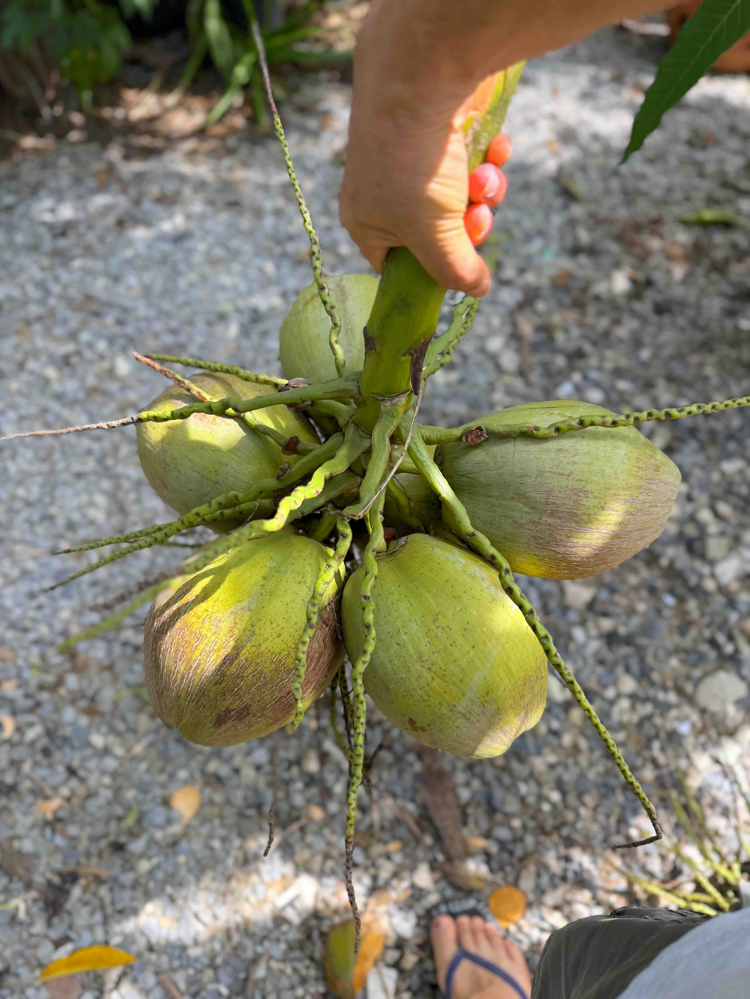
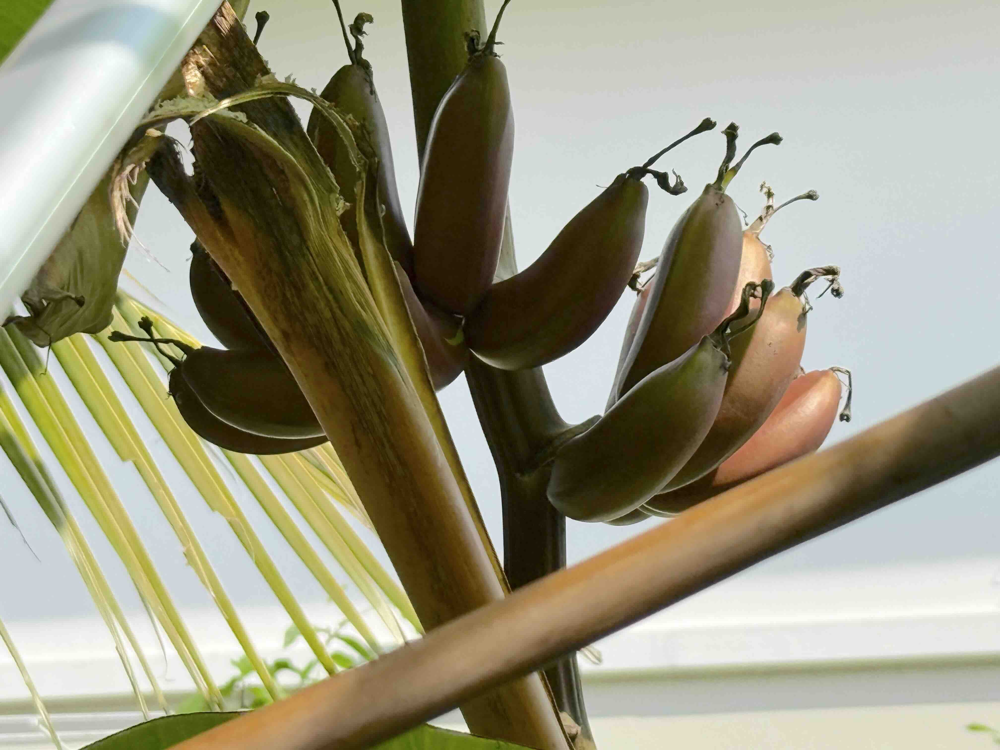
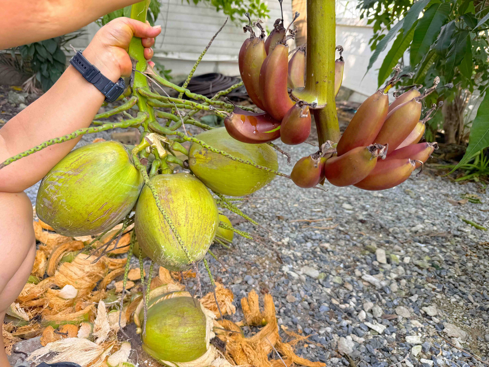
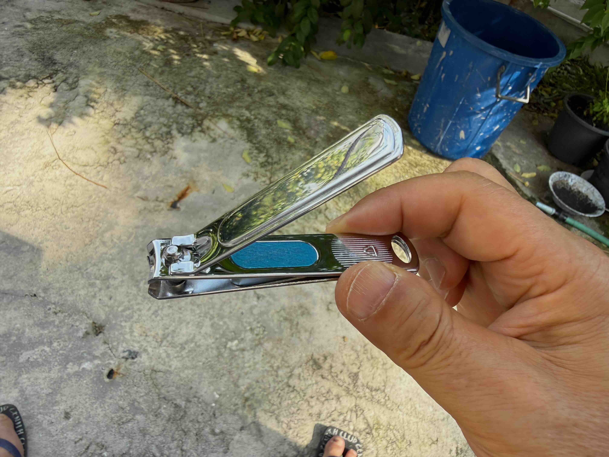
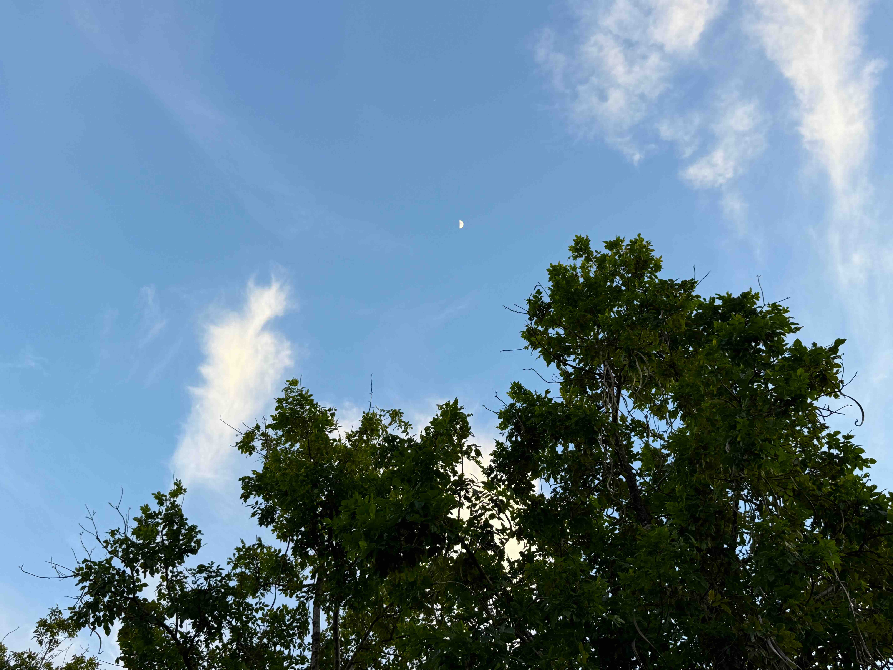
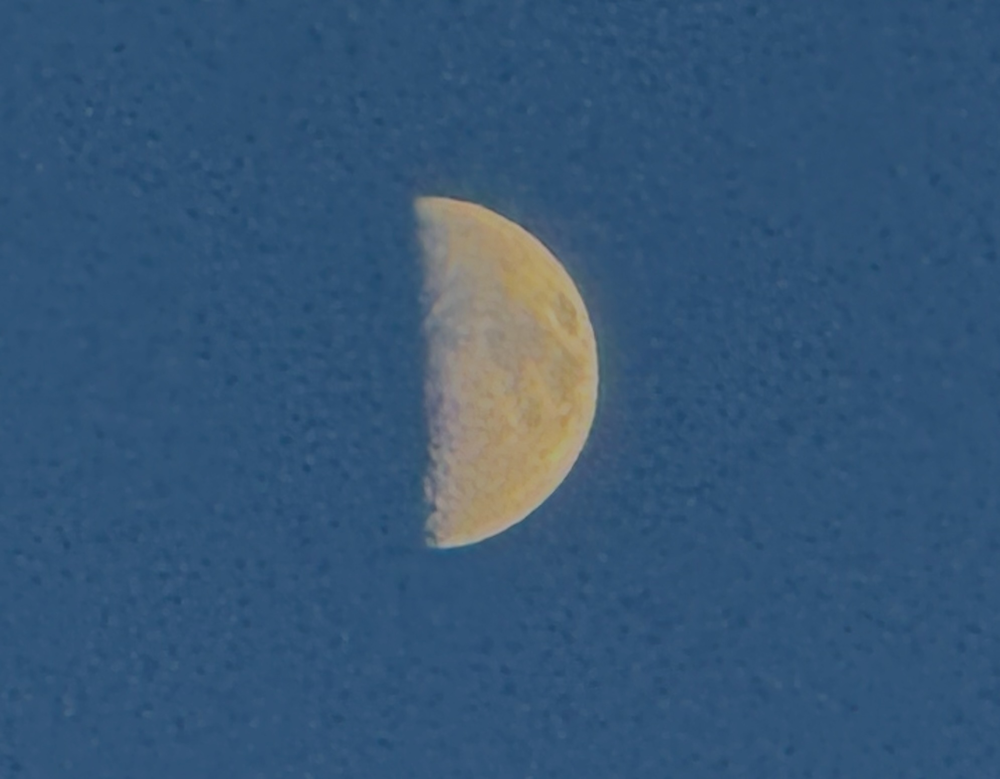
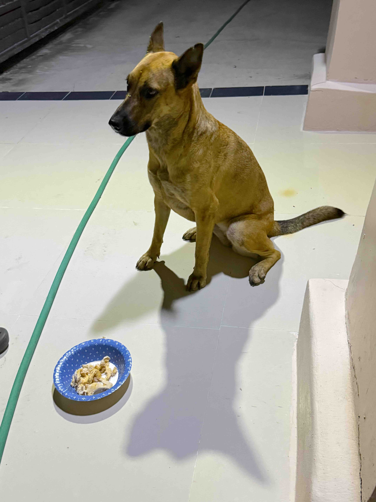

# 20261118_bangkok

<html lang="ja" data-loaded="false" data-scrolled="false" data-spmenu="closed">
<head>

<meta charset="UTF-8">
<meta http-equiv="Content-Type" content="text/html; charset=UTF-8">
<meta http-equiv="X-UA-Compatible" content="IE=EmulateIE10" />
<meta http-equiv="X-UA-Compatible" content="IE=edge">

<meta name="viewport" content="width=device-width, initial-scale=1.0">

<!--ここから上はお決まりの定型文です-->

<!--ここからが表現の書式などを決めるcssという部分-->

<link href="https://cdnjs.cloudflare.com/ajax/libs/lightbox2/2.7.1/css/lightbox.css" rel="stylesheet">

</head>

<body>
    
<!--
    
<a href="https://peyng.github.io/restart/">前回までの記録</a>><a>今回2026,05,28</a>

-->

モバイル端末をお使いの場合は、画面を横向きにすると
背景画像の横方向がご覧頂けます。

<!--ここ上は、ほぼそのまま使います！-->

<!--QRコードの挿入例-->

 QR for Access

<marquee direction="left" scrollamount="20" width="30%">(^_^)/~alis</marquee>

<!--流れ文字の挿入例-->
<h1><marquee behavior="left">!!! 2026/11/18、庭の果物収穫から、市場で買い物して犬に餌やりまで  !!!</marquee></h1>

<!--ここから下が、本体部分-->

<h2>2026/Nov/17日、庭の木からパパイヤを収穫</h2>

<h2>バナナも実ってます</h2>

<h2>まだまだ採れますが、これだけあれば十分</h2>

<h2>タイの爪切り、綺麗ですがヤスリが付いてません</h2>

<h2>午後のお空にお月様</h2>

<h2>月齢7.4日で、うさぎさんの耳が見えてます</h2>

<h2>夕方の東の空に、夕陽を浴びた入道雲が色づきました</h2>

<h2>市場の向こうには綺麗な夕暮れ</h2>

<h2>お肉のディスプレーがダイレクト</h2>

<h2>東の空の入道雲がさらに色つきました</h2>

<h2>市場内、人の流れが途切れた隙に一枚パチリ</h2>

<h2>晩御飯のおかずを購入</h2>

<h2>いつものお花屋さん、店長はお兄さんのお母さん？</h2>

<h2>市場の屋根上の雲も綺麗に染まりました</h2>

<h2>コンビニ前にたむろするワンちゃんたち、4匹居ます</h2>

<h2>コンビニ敷地内の食堂も盛況</h2>

<h2>コンビニでワンちゃんのご飯買ってあげました</h2>

<h2>黒が一番元気に食べてます</h2>

<h2>茶は食べる元気なし・・・</h2>

<h2>喉が渇いていたようです</h2>

<h2>一番奥の茶は病気で元気なし</h2>

<h2>住宅エリアに戻ると、町内で飼い慣らされたワンちゃんが餌ねだり</h2>

<h2>子供の頃から住んでて、躾もしっかれされてます</h2>

<!--
<h2>11,Nov、バンコク市内を走るモノレール</h2>

    

-->

<h2>Moon age</h2>
    <h2>
<a href="https://starwalk.space/ja/moon-calendar" target="_blank">Moon age Link</a>
</h2>

<h2>今日のBGMは、1日5分聴けばすべての病気が消える - チベットフルート、すべての負のエネルギーを取り除く</h2>

<iframe width="560" height="315" src="https://www.youtube.com/embed/lkoSysvIXyM?si=-FUMZupVQ3V7NHAS" title="YouTube video player" frameborder="0" allow="accelerometer; autoplay; clipboard-write; encrypted-media; gyroscope; picture-in-picture; web-share" referrerpolicy="strict-origin-when-cross-origin" allowfullscreen></iframe>
    

   
<h2>2026Nov18、庭の果物収穫から、市場で買い物して犬に餌やりまででした Thank you for reading this far.</h2>
<!--
     
<h2>
<a href="https://torokoid.github.io/Mashiko_himawari_3/" target="_blank">クリックでメニューページに戻ります</a>
</h2>
-->

   

<!-- hitwebcounter Code START -->
<a href="https://www.hitwebcounter.com" target="_blank">

you are visitor The numbers are cumulative for the Bangkok ＆ Utsunomiya series websites launched since 2025 August 1st.
</a>   

<!--本体はここまで-->
    

<!--画面に空白地帯を作って、背景が見えるようにしています-->

<!-- フッタ -->
<footer>

Copyright 2026/11/18 alis

</footer>

<!--HPにさまざまなJavaScriptを呼び込むための書式-->

    
    </body>
    
</html>
